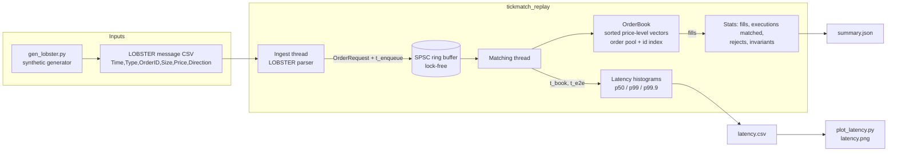
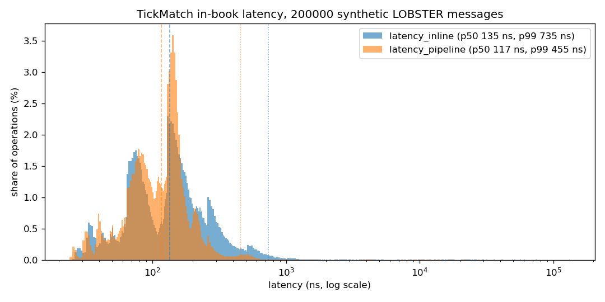

# TickMatch

[](https://github.com/Vrajesh-works/TickMatch/actions/workflows/ci.yml)

TickMatch is a small, readable C++20 limit order book matching engine. It
matches limit and market orders by price-time priority, handles cancels and
partial cancels, keeps price levels in a cache-friendly contiguous layout, and
feeds the matching thread from a lock-free single-producer single-consumer
queue. It replays exchange-format (LOBSTER) message files and reports latency
as p50/p99/p99.9 histograms in nanoseconds, not averages. Correctness is pinned
down by a differential fuzz test against a reference book that also asserts the
book never crosses and every order's quantity is conserved.

There is no hosted deployment yet: the engine is a local library and CLI, and
every cloud piece is listed under [Roadmap](#roadmap). Everything runs locally
with one command.

## Architecture



- `tickmatch` (static library): order book, SPSC queue, latency histogram,
  LOBSTER parser and replay engine. No I/O on the matching path.
- `tickmatch_replay` (CLI): replays a LOBSTER file in `inline` mode (parse,
  then match on one thread) or `pipeline` mode (ingest thread and matching
  thread joined by the SPSC queue).
- `tickmatch_bench`: Google Benchmark microbenchmarks.
- `client/` (Python): synthetic LOBSTER generator, replay driver, latency plot.

The product document is [docs/PRODUCT.md](docs/PRODUCT.md) and the technical
plan (data model, order semantics, test strategy) is
[docs/PLAN.md](docs/PLAN.md).

## Quick start

With Docker only (builds the image, runs every test inside the build stage,
then generates 200k synthetic messages, replays them in both modes and writes
results to `./out`):

```sh
make docker            # or: HOST_UID=$(id -u) HOST_GID=$(id -g) docker compose up --build demo
ls out/                # summary_*.json, latency_*.csv, latency.png, messages.csv
docker compose run --rm bench   # microbenchmarks
```

With a local toolchain (C++20 compiler, CMake 3.24+, Ninja, Python 3.10+;
GoogleTest and Google Benchmark are fetched by CMake):

```sh
make test              # Release build + unit and integration tests
make demo              # needs `pip install -e "client[plot]"` for the plot
make bench
```

Replay any LOBSTER message file yourself:

```sh
build/release/apps/tickmatch_replay --input data/sample/synthetic_messages.csv \
    --mode pipeline --hist-csv out/latency.csv --summary-json out/summary.json
```

Using the library:

```cpp
#include "tickmatch/order_book.hpp"
using namespace tickmatch;

OrderBook book{1 << 20};               // preallocated order pool
std::vector<Fill> fills;
book.add_limit(1, Side::Sell, 1'000'100, 300, fills);   // rests
book.add_limit(2, Side::Buy, 1'000'100, 100, fills);    // fills 100 against order 1
book.add_market(3, Side::Buy, 500, fills);              // takes the rest, remainder cancelled
book.cancel(1);                                         // RejectUnknownId: already filled
```

### Replaying real LOBSTER data

LOBSTER message files (`<TICKER>_<date>_..._message_<levels>.csv`) load
directly with `--input`. Message types 1 (submit), 2 (partial cancel), 3
(delete) and 4 (visible execution) map onto engine requests; type 4 becomes an
opposite-side market order so replay exercises the matching path and checks
that it hits the named resting order. Types 5 (hidden execution), 6 (cross
trade) and 7 (halt) are skipped and counted. Real files start mid-session, so orders
placed before the first message are unknown to the book: expect some
`unknown id` rejects and unmatched executions in the summary for those, while
the book invariants still hold.

## Running tests

| Command | What runs |
| --- | --- |
| `make test` | all 58 CTest tests (56 GoogleTest cases + 2 replay integration tests) |
| `make unit` / `make integration` | the two groups separately |
| `make asan` | Debug build with AddressSanitizer + UndefinedBehaviorSanitizer |
| `make tsan` | ThreadSanitizer build (SPSC queue and pipeline replay) |
| `make py-test` | pytest for the Python client |
| `make lint` | clang-format check and ruff |
| `make docker-test` | the Docker build stage, which runs the full suite |

CI ([.github/workflows/ci.yml](.github/workflows/ci.yml)) runs lint, Release
builds and tests on gcc and clang, ASan/UBSan and TSan jobs, the Python tests,
a benchmark smoke run, and the Docker image plus the compose demo end to end.

### What the tests check

- **Unit**: every order path (limit rest and cross, market sweep and
  remainder cancel, partial fills, FIFO within a level, cancel, reduce keeps
  priority, duplicate/unknown/invalid rejects, pool capacity), the id index,
  SPSC wrap-around and a two-thread ordering test, histogram percentiles, the
  LOBSTER parser.
- **Differential fuzz** (`tests/test_fuzz.cpp`): 240k random limit, market,
  cancel and reduce requests across 6 seeds (two with tiny pools to force
  capacity rejects) are applied to TickMatch and to a `std::map` +
  `std::deque` reference book. Statuses and fills must match exactly. After
  every step: the book is not crossed (best bid < best ask), level totals and
  counts equal their orders, and for every order submitted = filled + resting
  + cancelled.
- **Integration**: `tickmatch_replay` replays the committed 10k-message sample
  in both modes; CTest checks the JSON summary (no rejects, every LOBSTER
  execution matched against the named order, invariants ok).

## Results

200,000 synthetic LOBSTER messages (84k limits, 24k executions as market
orders, 72k deletes, 20k partial cancels), `docker compose up` on a WSL2
laptop, Release build with gcc 13. In-book latency is the time inside
`OrderBook::submit` per request, measured with `steady_clock` (about 25 ns of
timer overhead is included).

| Mode | Throughput | p50 | p90 | p99 | p99.9 |
| --- | --- | --- | --- | --- | --- |
| inline | 5.0M msg/s | 135 ns | 303 ns | 735 ns | 1.3 us |
| pipeline (unpaced) | 6.2M msg/s | 117 ns | 207 ns | 455 ns | 623 ns |

All 24,166 executions hit the resting order LOBSTER named, with 0 rejects
and invariants ok in both modes.



Ingest-to-match (e2e) latency through the SPSC queue only means something
when ingest is paced below the matching rate; unpaced, it measures queue
backlog. With `--rate`:

| Ingest rate | e2e p50 | e2e p90 | e2e p99 |
| --- | --- | --- | --- |
| 200k msg/s | 487 ns | 1.3 us | 52 us |
| 1M msg/s | 543 ns | 10 us | 885 us |

These are laptop numbers inside a container on WSL2 with no core pinning, so
the tails include scheduler noise.

Microbenchmarks (`make bench` or `docker compose run --rm bench`, same
machine):

| Benchmark | Time per op | Notes |
| --- | --- | --- |
| Add + cancel passive order, 100 / 10k / 100k resting | 71 / 87 / 136 ns | pair of operations |
| Match at the touch, 100 / 10k resting | 22 / 55 ns | fill plus replenish |
| Market order sweeping 5 levels | 1.6 us | includes restoring the swept liquidity |
| Mixed stream (55% limit, 30% cancel, 15% market) | 40 ns | 24.7M requests/s |
| SPSC queue transfer between two threads | 17 ns | 59.7M items/s |
| Histogram record | 2.1 ns | |

## Design notes

- **Price levels**: one sorted `std::vector<PriceLevel>` per side with the
  best price at the back. Adding near the touch, matching at the touch and
  removing an emptied best level are amortized O(1) `push_back`/`pop_back`
  with no pointer chasing; other levels are found by binary search.
- **Orders**: a preallocated pool of 32-byte slots with a free list, linked
  into per-level FIFO lists by 32-bit indices. No heap allocation per order
  once warmed up; a full pool rejects instead of growing.
- **Cancel lookup**: an open addressing hash map from order id to pool slot,
  so cancel and reduce are O(1) plus a binary search for the level.
- **SPSC queue**: power-of-two ring buffer, head and tail on separate cache
  lines, and each side caches the other's index so it only touches the
  other's cache line when the queue looks full or empty. Acquire/release
  ordering only.
- **Latency histogram**: fixed log-linear buckets (32 sub-buckets per power
  of two, at most about 3% relative error), allocation free on record.
- **Prices** are integer ticks (LOBSTER's dollars x 10000), so there is no
  floating point on the matching path.

## What broke and how I fixed it

- **No C++ compiler on the dev machine.** The WSL box had no system
  compiler, no sudo, and the user-level toolchain download was blocked. I
  moved every build into Docker (an Ubuntu 24.04 image with gcc 13 and clang
  18) and made the Dockerfile's build stage run the whole CTest suite, so
  `docker build` is itself a test gate locally and in CI.
- **The root Makefile was silently untracked.** The GitHub CMake
  `.gitignore` template ignores every file named `Makefile` (meant for
  generated ones). `make` worked locally while the file never reached git; I
  caught it when `git ls-files` did not list it while wiring CI to call
  `make` targets. Fixed by removing that pattern, since all generated build
  files live under `build/`, which is ignored anyway.
- **ThreadSanitizer refused to start.** The WSL2 kernel uses high mmap
  ASLR entropy that the TSan runtime shipped with the distro compilers does
  not support, so TSan binaries (including CTest's test discovery step)
  aborted at startup. The `make tsan` target runs the build and tests under
  `setarch -R`, and CI lowers `vm.mmap_rnd_bits` before the TSan job.
- **End-to-end latency looked like milliseconds.** The first pipeline run
  reported e2e p50 of about 4 ms while in-book p50 was about 120 ns. The
  ingest thread parses faster than the book matches, so the queue fills and
  e2e measures backlog, not handoff cost. Pacing ingest with the replay's
  `--rate` option gives the real handoff cost: at 200k msg/s the e2e p50 is
  under 0.5 us. The results below report both and say which is which.
- **Real LOBSTER samples could not be fetched by script.** lobsterdata.com
  serves its free samples through a JavaScript app with no direct file URL.
  Rather than block on it, the Python generator writes internally consistent
  streams in the exact LOBSTER message format (and validates them against a
  reference book), and the parser is format-compatible with real files.

## Roadmap

Not built yet:

- **Cloud (deferred by design)**: push the image to AWS ECR or Azure ACR,
  host a benchmark dashboard on S3 or Azure Blob static hosting, run
  scheduled benchmarks on dedicated EC2 or Azure VM instances with pinned
  cores, and manage it with Terraform or Bicep. The engine has no cloud
  dependency, so these are adapters around the existing image and the
  CSV/JSON outputs.
- **Liquibook comparison**: run the same order stream through Liquibook and
  TickMatch and publish a side-by-side latency write-up.
- **Real data results**: replay results on real LOBSTER sample days and book
  state checks against Optiver Realized Volatility snapshots (Kaggle login
  required).
- Order modify with price change, iceberg and stop orders, self-trade
  prevention, multiple instruments with symbol routing.
- Core pinning, huge pages and busy-poll tuning for latency runs.

## Built with / inspired by

- [LOBSTER](https://lobsterdata.com/) - the message file format
  (Time, Type, OrderID, Size, Price, Direction) that the parser reads and the
  synthetic generator writes. No LOBSTER data is redistributed here.
- [Liquibook](https://github.com/enewhuis/liquibook) - design reference for
  what a C++ matching engine exposes (order types, fills, book depth). No
  Liquibook code is used; the benchmark comparison is future work.
- [HdrHistogram](https://github.com/HdrHistogram/HdrHistogram) - the
  log-linear bucket idea behind the latency histogram (own implementation).
- [GoogleTest](https://github.com/google/googletest) and
  [Google Benchmark](https://github.com/google/benchmark) - fetched by CMake.
- [matplotlib](https://matplotlib.org/) - latency plots.

## License

MIT, see [LICENSE](LICENSE).
