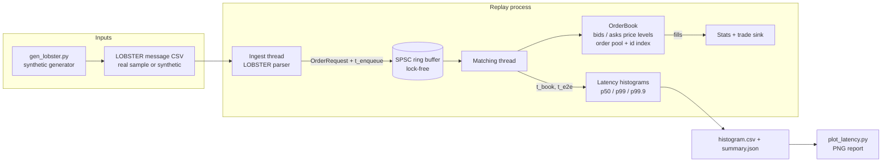

# TickMatch - Technical Plan

## Architecture

The engine is a library (`tickmatch`) with no I/O in the hot path. The replay
application wires the parser, the SPSC queue, the matching thread and the
histograms together. Tests and benchmarks link the same library.

## Data model

| Type | Fields | Notes |
| --- | --- | --- |
| `Price` | `int64_t` ticks | LOBSTER prices are dollars x 10000, used as ticks directly |
| `Qty` | `uint32_t` | per order; level totals are `uint64_t` |
| `OrderId` | `uint64_t` | caller supplied, unique among live orders |
| `OrderRequest` | type (limit, market, cancel, reduce), side, id, price, qty | one message into the engine |
| `Order` (pool slot) | id, price, qty remaining, side, prev, next (`uint32_t` indices) | 32 bytes, lives in a preallocated pool with a free list |
| `PriceLevel` | price, total qty, order count, head, tail | contiguous `std::vector` per side, sorted so the best price is at the back |
| `Fill` | maker id, taker id, price, qty, maker fully filled flag | appended to a caller-owned buffer |

Why this layout:

- Best price at the back of a sorted vector makes the common operations
  (add near the touch, match at the touch, remove an emptied best level)
  O(1) amortized `push_back` / `pop_back` with no pointer chasing.
- Orders live in one pool and link by 32-bit index, so a level is a FIFO
  list without per-order heap allocation and with good locality.
- An id index (open addressing hash map) gives O(1) cancel lookup; the level is
  then found by binary search on the price vector.

## Order semantics

- **Limit**: match against the opposite side while the opposite best price is
  at or better than the limit price; any remainder rests at the limit price
  behind existing orders at that price.
- **Market**: match until filled or the opposite side is empty; remainder is
  cancelled (never rests).
- **Cancel**: remove the live order; unknown ids are rejected and counted.
- **Reduce**: decrease a live order's quantity, keeping its time priority;
  reducing to zero removes it.
- Duplicate live ids and zero quantities are rejected.

## Milestones (today)

1. Docs: this plan and `PRODUCT.md`.
2. Build skeleton: CMake with FetchContent for GoogleTest and Google
   Benchmark, presets for release, debug sanitizers and TSan.
3. Core library: types, order pool, price levels, matching, cancel, reduce.
4. Unit tests for every order path, then the randomized differential test
   against a `std::map`-of-`std::deque` reference book with invariant checks.
5. Lock-free SPSC queue with unit and two-thread tests.
6. Latency histogram with percentile tests.
7. LOBSTER parser and replay application (two-thread pipeline), integration
   test on a committed synthetic sample.
8. Python client: synthetic generator, replay driver, latency plot, pytest.
9. Google Benchmark suite.
10. CI, Dockerfile, docker compose, Makefile, PR and issue templates, README.

## Test strategy

| Layer | What | Where |
| --- | --- | --- |
| Unit | each order type, partial fills, priority, cancels, rejects, reduce | `tests/test_order_book.cpp` |
| Property / fuzz | random streams compared fill by fill to a reference book; after every step: best bid < best ask, level totals equal the sum of their orders, submitted qty = filled + resting + cancelled for every order | `tests/test_fuzz.cpp` |
| Concurrency | SPSC FIFO order and no loss across two threads, run under TSan in CI | `tests/test_spsc_queue.cpp` |
| Parser | LOBSTER field parsing and message mapping | `tests/test_lobster.cpp` |
| Integration | run `tickmatch_replay` on the committed sample and check its JSON summary | `tests/integration/` via CTest |
| Python | generator output format, replay driver | `client/tests/` with pytest |
| Performance | microbenchmarks (not gated) | `bench/` |

## Future work

Deferred, not built today:

- **Cloud (out of scope for this task)**: container registry push (AWS ECR or
  Azure ACR), a hosted benchmark dashboard (S3 or Azure Blob static site),
  scheduled benchmark runs on dedicated cloud instances (EC2 or Azure VM with
  pinned cores), Terraform or Bicep for that infrastructure. The engine has no
  cloud dependency, so these would be deployment adapters around the existing
  Docker image and CSV/JSON outputs.
- **Liquibook comparison**: run the same order stream through Liquibook and
  TickMatch and publish a side-by-side latency write-up.
- **Optiver Realized Volatility data**: use the Kaggle book snapshots for
  book-state checks (requires a Kaggle login).
- Order modify (price change), iceberg and stop orders, self-trade prevention.
- Multiple instruments with one book per symbol and symbol routing.
- Kernel-bypass style ingest, core pinning and huge pages for latency runs.
